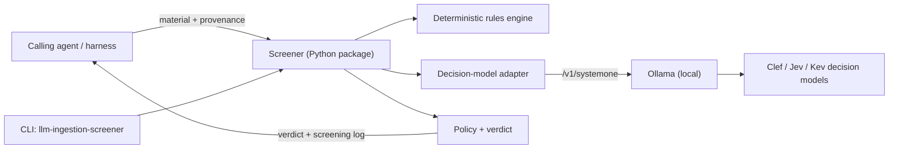

# Architecture

Technical architecture for `llm-ingestion-screener`. This hub covers how the system is built and deployed. Domain meaning lives in [`DOMAIN-MODEL-L1.md`](DOMAIN-MODEL-L1.md). Do not mix the two.

## System in one paragraph

The screener is a local-first Python component with no network dependency except to a locally hosted decision-model endpoint. A caller hands it one piece of inbound material plus provenance; the screener runs deterministic pattern rules, then typed decision-model questions over the remainder, then applies a policy that maps answers to a typed verdict. It returns the verdict, the per-question probabilities, the verbatim flagged passages, and a screening-log row. It runs on the operator's workstation, offline, against a local Ollama endpoint exposing System One models.

## C4 references

Spokes live under [`technical-architecture/`](technical-architecture/README.md):

- [`c4/context.md`](technical-architecture/c4/context.md) — the system, its actor (the calling agent), and external systems (Ollama endpoint, embedding cache)
- [`c4/container.md`](technical-architecture/c4/container.md) — the library, the CLI, the model adapter, the rules engine
- [`c4/component.md`](technical-architecture/c4/component.md) — components inside the screener container
- [`c4/deployment.md`](technical-architecture/c4/deployment.md) — where it runs, and the staging/production split

## Container view

## Tech stack

See [`technical-architecture/tech-stack.md`](technical-architecture/tech-stack.md). In short: Python 3.11+ managed with `uv`, pytest for tests, HTTP to a local Ollama endpoint, no hosted services.

## Deployment topology

One container shape: a library plus its CLI, installed into a virtual environment. "Staging" is a built wheel installed into a fresh venv from a branch (`scripts/staging/deploy.sh`); "production" is a tagged release of the same wheel. There is no server. Full detail in [`c4/deployment.md`](technical-architecture/c4/deployment.md).
