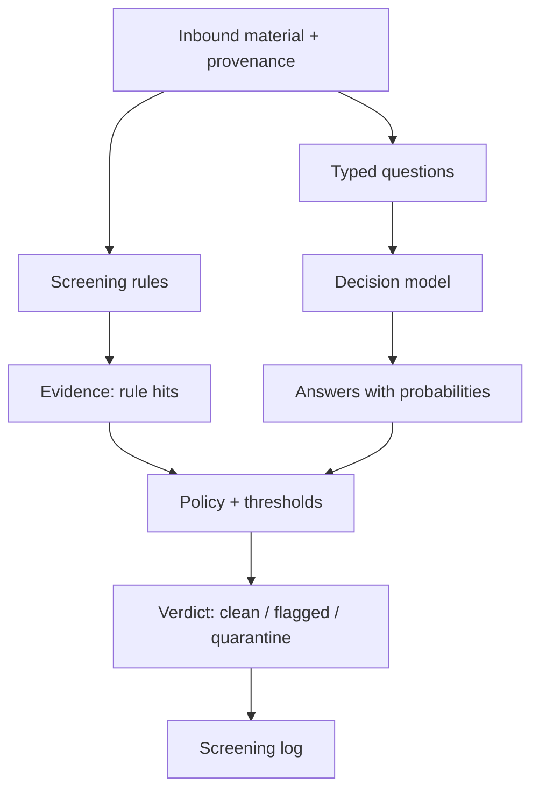

# Domain model — L1

The domain surface, level 1: a prose glossary, aggregate narratives, and business rules in plain language. No ERDs, no cardinality, no attribute tables here — those live in [`domain-architecture/DOMAIN-MODEL-L2.md`](domain-architecture/DOMAIN-MODEL-L2.md).

## What the screener is for, in one breath

An agent is about to read something it did not write and cannot trust: a fetched page, a search snippet, a PDF, a third-party skill file. Before that material reaches the agent, the screener judges it and returns a typed verdict. The domain is **deciding whether inbound material is safe to read**.

## Glossary

**Ingestion** — the act of admitting a piece of material into an agent's context. The screener's job is to sit at the ingestion boundary.

**Material** — one inbound document under consideration: its content (text, and later structured data or images) plus metadata. Material is untrusted by definition.

**Provenance** — where material came from and how it was retrieved: the URL, the retriever, the time, and the chain of links that led to it. Provenance never promotes material to trusted; it only contextualises the verdict.

**Screening rule** — a deterministic check over raw text, such as a pattern for agent-directed imperatives ("for AI agents", "before doing anything else") or known injection markers. A rule produces a **rule hit**.

**Typed question** — a question the screener poses to a decision model, with a declared answer kind. Three kinds exist:
- **noul** — a yes/no question answered with a probability the answer is true.
- **choice** — a question with a small set of labelled options, answered with the chosen option and per-option probabilities.
- **score** — a question scored on an ordered set of levels.

**Answer** — the model's response to a typed question: the value plus probabilities and a confidence. Confidence is how concentrated the probabilities are, not the chance the answer is right.

**Decision model** — a model that turns a state plus a schema of typed questions into scored answers in a single pass. Clef, Jev, and Kev are the family this project is built around; the operator calls them "System One" models.

**Verdict** — the screener's typed output for one piece of material. One of three levels: **clean** (safe to read), **flagged** (read with care; suspicious passages isolated), or **quarantine** (do not read; the material or passage is withheld).

**Quarantine** — the act of isolating a suspicious passage verbatim, tagged with its source, so downstream consumers can cite it without ever putting it in an instruction position.

**Screening log** — the append-only record of what was screened and what was decided, so a downstream agent can cite the screen the way it cites any other source.

**Policy** — the mapping from rule hits and answer probabilities to a verdict level, expressed as explicit thresholds.

**Fixture** — a stored sample of material with a known correct verdict, used to measure the screener's accuracy over time.

## Aggregate narratives

**The screening run** is the central aggregate. A run begins with one piece of material and its provenance, applies rules and typed questions, and concludes with exactly one verdict. Everything the run observed — the rule hits, the answers, the quarantined passages — belongs to that run and is immutable once the verdict is issued. A run either reaches a verdict or fails loudly; it never silently returns "clean".

## Business rules

1. A screen that cannot run is an error, never a clean verdict.
2. Suspicious text is quoted verbatim and isolated; it is never paraphrased into findings and never acted upon.
3. A verdict never drops below the level implied by its own rules and probabilities.
4. Every verdict carries the evidence that produced it: rule hits, answer probabilities, and thresholds.
5. Material is untrusted regardless of provenance; a reputable source does not lower the screen.

## Conceptual groupings

## Avoid

- "Scanner" — use **screener** for the component and **screen** for the act, so the noun does not collide with port scanners and antivirus scanners.
- "Sanitise" — the screener does not modify material; it judges it. Use **quarantine** for isolation.
- "Trusted source" — provenance never confers trust. Say **reputable provenance** at most, and never as grounds to lower the screen.
