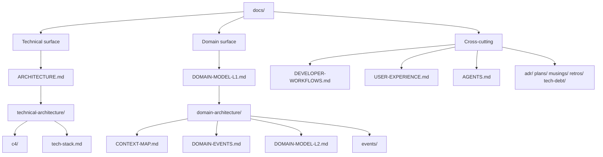

# docs/

Documentation for `llm-ingestion-screener`. Start here, then drill into the surface you need.

See [`PURPOSE.md`](../PURPOSE.md) for the one-paragraph intent and [`AGENTS.md`](../AGENTS.md) for agent guidance.

## The two architectural surfaces

The `docs/` tree is split into two surfaces with different audiences and cadences, plus cross-cutting hubs. Keep them separate; a hub never mixes surfaces.

## Technical architecture — how the system is built and deployed

- [`ARCHITECTURE.md`](ARCHITECTURE.md) — hub: C4 references, tech stack, deployment topology
- [`technical-architecture/c4/`](technical-architecture/c4/README.md) — context, container, component, deployment diagrams
- [`technical-architecture/tech-stack.md`](technical-architecture/tech-stack.md) — language, toolchain, and infrastructure choices

## Domain architecture — what the system means to its domain

- [`DOMAIN-MODEL-L1.md`](DOMAIN-MODEL-L1.md) — L1 prose glossary and aggregate narratives, at the surface
- [`domain-architecture/CONTEXT-MAP.md`](domain-architecture/CONTEXT-MAP.md) — bounded contexts and their relationships
- [`domain-architecture/DOMAIN-EVENTS.md`](domain-architecture/DOMAIN-EVENTS.md) — integration events crossing context boundaries
- [`domain-architecture/DOMAIN-MODEL-L2.md`](domain-architecture/DOMAIN-MODEL-L2.md) — L2 ubiquitous language: entities, value objects, invariants
- [`domain-architecture/events/`](domain-architecture/events/README.md) — event contract YAML specs

## Cross-cutting

- [`DEVELOPER-WORKFLOWS.md`](DEVELOPER-WORKFLOWS.md) — build, test, deploy, local dev
- [`USER-EXPERIENCE.md`](USER-EXPERIENCE.md) — the caller's experience, UX principles, quality attributes
- [`agents-detail/`](agents-detail/README.md) — agent-facing spokes
- [`adr/`](adr/README.md) — numbered decision records
- [`plans/`](plans/README.md) — implementation plans and specs
- [`musings/`](musings/README.md) — pre-artifact thought capture
- [`retros/`](retros/README.md) — post-session reflections
- [`tech-debt/`](tech-debt/README.md) — pre-existing errors and debt too complex to fix inline
- [`test-coverage-matrix.md`](test-coverage-matrix.md) — master test coverage matrix
