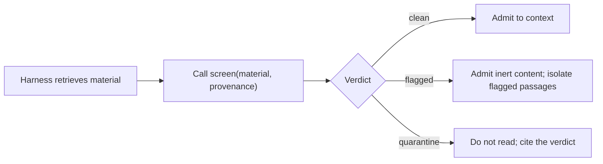

# User experience

The "user" of `llm-ingestion-screener` is twofold: the **agent harness** that calls the screener programmatically, and the **operator** who runs it from a shell and tunes it. There is no graphical surface. Spoke detail lives under [`user-experience/`](user-experience/README.md).

## UX principles

1. **One call, one verdict.** A caller passes material and provenance and gets a typed verdict back. No session state, no configuration dance at call time.
2. **The verdict is the product.** The verdict plus its evidence is everything a caller needs; a caller should never need to look at raw material to act on a screen.
3. **Failed screens are loud.** A caller can trust that a returned `clean` verdict means the screener actually ran.
4. **Offline by default.** Nothing leaves the workstation, and no call reaches the network beyond the local model endpoint.
5. **Cheap enough to run always.** The screen must fit inside the caller's latency budget; a screen too slow to run always will not be run always.

## Caller journey

## Quality attributes

| Attribute | Target |
|---|---|
| Latency | Within the caller's budget for a typical page (Clef's median latency is ~210 ms per forward pass on the local model; multiple questions share one pass). |
| Availability | Local, so availability equals the workstation's. |
| Safety | No returned verdict is ever less strict than its evidence implies. |
| Auditability | Every verdict carries the evidence and thresholds that produced it. |
| Portability | Runs on macOS with no GPU; degrades to cloud Ollama only if the operator opts in. |

## Accessibility

No UI, so the accessibility surface is textual: CLI output and log lines are plain UTF-8 with no colour-only signalling. The CLI must remain usable with a screen reader and in a pipe.
