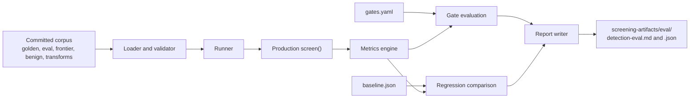

# Detection eval harness

- **Status:** Phase 2 implemented 2026-11-04. The corpus is a starter set; Phase 3 expands it from the public benchmarks.
- **Plan:** [`docs/plans/2026-10-29-ingestion-screener-eval-harness.md`](../plans/2026-10-29-ingestion-screener-eval-harness.md), sections 5 to 8.
- **Production contract:** [`docs/domain-architecture/SCREENING-CORE.md`](../domain-architecture/SCREENING-CORE.md).

The harness measures one question: given this project's own inbound material, how often does the production screen reach the right verdict, and at what cost in false alarms. It loads stored fixtures with known truth, runs them through the same rule engine, typed questions, and policy that ship, and writes a Markdown and JSON report.



## Run

The default gate is offline, deterministic, and needs no model:

```bash
uv run pytest -q
```

Run the harness directly to refresh the gitignored report:

```bash
uv run python -m llm_ingestion_screener.eval run
```

The command exits zero only when every gate holds, the recorded batch is byte-identical across two runs, the malformed-answer probe raises, and both report artefacts are written. A validation error exits 2; a failed gate or regression exits 1.

Accepted output is recorded deliberately, never by an ordinary run:

```bash
uv run python -m llm_ingestion_screener.eval run --update-baseline
```

## Corpus

```text
tests/fixtures/screener-corpus/
├── golden/       exact-output regression, checked against the baseline
├── eval/         truth-labelled quality set, feeds the gated recall metric
├── frontier/     hard cases expected to be missed; reported, not gated
├── benign/       benign hard negatives; feeds the false-positive ceiling
└── transforms/   named evasion variants derived from eval fixtures
```

Every fixture is one YAML mapping following plan section 5.1. The loader rejects a run on an unknown verdict, a missing label, a duplicate id, a missing `provenance` for `real-sanitized` or `benchmark-derived`, a non-`example.invalid` host in an exfiltration or command-and-control position, an empty corpus directory, a missing directory, a bad derivation, an unknown expected rule id, or an unknown field.

Fixtures are sanitised before they enter the repository. Hosts are `example.invalid`, secrets are stripped, and the behavioural shape is kept without a live payload.

## Gate registry

[`tests/eval/gates.yaml`](../../tests/eval/gates.yaml) tags every one of the plan's 19 metrics as `gated` or `reported`. Promoting a metric is an explicit reviewed edit.

The operator ruling of 2026-11-04 is in force:

- malicious recall is gated at 90% on `golden/` and `eval/`;
- the benign false-positive ceiling is gated below 10%;
- the frontier set is reported, not gated;
- byte-identical recorded runs, malformed answers failing the batch, complete evidence records, and corpus-coverage floors are gated.

Coverage floors are per directory, per ingestion surface, and per threat class, so deleting fixtures cannot turn a red result green.

## Metrics

The engine is pure arithmetic over counts. It imports no numpy and no scikit-learn.

| Status | Metrics |
|---|---|
| Gated | malicious recall, benign false-positive rate, determinism, evidence-record well-formedness, malformed-answer batch failure, corpus coverage |
| Reported and computed | per-class recall, evasion blocked rate, evasion rule retention, frontier recall, per-surface recall and FPR |
| Reported, not applicable in Phase 2 | blocked-task share (no task id in the schema), detection at a fixed FPR (the verdict is ordinal), latency (recorded client), calibration (no single probability per fixture), out-of-distribution recall (no held-out split), rule-only lift (no control run), format sensitivity (no normalisation pass), threshold sensitivity (no threshold sweep) |

Every not-applicable row carries its reason in the report.

## Baseline

[`tests/eval/baseline.json`](../../tests/eval/baseline.json) holds the last accepted value of every metric, the corpus fingerprint, and each fixture's verdict and rule ids.

A run distinguishes three cases:

1. Same fingerprint and a worse gated metric: a regression, and the command fails.
2. Same fingerprint and a changed `golden/` verdict or rule set: an exact-output regression, and the command fails.
3. A changed fingerprint: a corpus change. Metric deltas are reported as corpus changes, not regressions; the gates still apply to the new corpus.

## Determinism and fail-loud

The recorded run screens every fixture twice and compares the canonical JSON signatures. The clock is fixed per fixture, provenance is derived from the fixture id, and the committed cassette is explicitly synthetic.

The runner passes only fixture content, surface, and provenance into `screen()`. It never passes the truth label, the expected verdict, or the threat class. A fixture labelled malicious whose content is benign screens clean.

A malformed decision-model answer is probed through the production path on every run. The probe must raise `MalformedAnswerError`; any other outcome fails the gated `malformed_answer_batch_failure` metric. A report that cannot be written raises and fails the command.

## Out of scope in Phase 2

The full Phase 3 corpus, the Phase 4 transform suite beyond the two starter variants, the Phase 5 head-to-head, live latency and calibration measurement, and the Phase 6 generators. The live client and its opt-in `model` run still exist in Phase 1 form, but the harness CLI exposes only recorded mode until Phase 5 defines its operating point.
