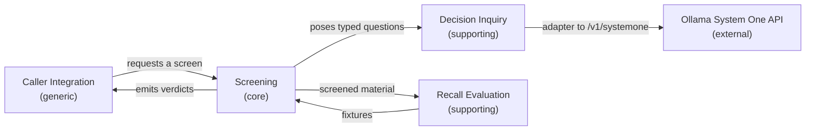

# Context map

Bounded contexts in `llm-ingestion-screener` and how they relate. Four contexts, one core.

## Contexts

**Screening (core)** — owns the verdict. Holds the rules engine, the question set, the policy, and the screening log. This is where the domain's value and its complexity live.

**Decision Inquiry (supporting)** — poses typed questions to a decision model and normalises the scored answers. It is an anticorruption layer over the System One HTTP API: the rest of the system never sees request/response shapes, only typed questions and answers.

**Recall Evaluation (supporting)** — measures the screener against stored fixtures: did it catch known injections, did it leave clean material alone? Owns the golden set and the accuracy numbers.

**Caller Integration (generic)** — how an agent harness or CLI invokes the screener and consumes the verdict. Deliberately thin; no domain logic belongs here.

## Relationships

| Upstream | Downstream | Pattern | Note |
|---|---|---|---|
| Caller Integration | Screening | Customer / supplier | The caller supplies material and provenance, receives a verdict. |
| Screening | Decision Inquiry | Partnership | The question schema and the answer normalisation evolve together. |
| Decision Inquiry | System One API | Anticorruption layer | Model-specific request shapes are confined to the adapter. |
| Recall Evaluation | Screening | Conformist | Evaluation consumes the same verdict shape the caller does. |

## Notes

- The **Screening** context is the only place allowed to decide a verdict, so thresholds and rules have a single home.
- Replacing the model family (Clef today, another tomorrow) should touch only **Decision Inquiry**.
