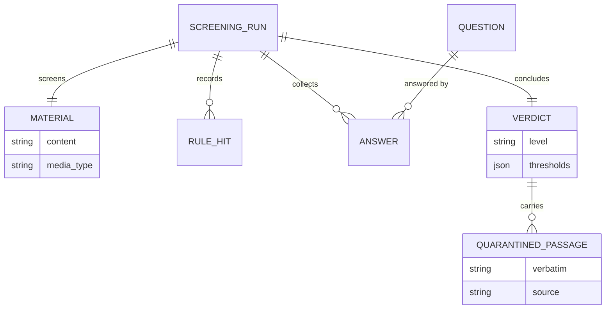

# Domain model — L2

Level 2 ubiquitous language for developers and agents: entities, value objects, aggregates, invariants, and the internal model. The prose glossary is [`../DOMAIN-MODEL-L1.md`](../DOMAIN-MODEL-L1.md).

## Aggregates and entities

**ScreeningRun** (aggregate root) — one screening of one piece of material. Owns the rule hits, the answers, and the verdict for that material. Immutable once the verdict is issued.

- **Material** (entity/value) — content plus media type. Untrusted.
- **Provenance** (value object) — source URL, retriever, retrieved-at, and the referring URL if any.
- **RuleHit** (value object) — rule id, matched span, verbatim excerpt, position.
- **Question** (value object) — id, kind (`noul` | `choice` | `score`), instructions, criteria.
- **Answer** (value object) — question id, value, per-option probabilities, confidence.
- **Verdict** (entity) — level (`clean` | `flagged` | `quarantine`), the answers and hits it rests on, and the thresholds in force.
- **QuarantinedPassage** (value object) — verbatim text, source, and the rule or question that flagged it.

**Fixture** (separate aggregate, owned by Recall Evaluation) — material reference, expected verdict, and the rationale for the expectation.

## Value objects

| Name | Fields | Invariant |
|---|---|---|
| `Material` | `content`, `media_type` | Content is never interpreted as instructions. |
| `Provenance` | `source_url?`, `retriever`, `retrieved_at`, `referrer?` | A provenance with no retriever is invalid. |
| `Question` | `id`, `kind`, `instructions`, `criteria?` | `choice` and `score` require criteria; `noul` may omit them. |
| `Answer` | `question_id`, `value`, `probabilities`, `confidence` | Probabilities sum to 1 within tolerance. |
| `Threshold` | `metric`, `op`, `value` | The op is one of the declared comparisons. |

## Invariants

1. Exactly one verdict per screening run.
2. A run ends in a verdict or an error; "clean by default" is impossible.
3. Every quarantined passage is stored verbatim with its source; none is paraphrased.
4. A verdict's level is a total order: `clean < flagged < quarantine`. The level equals the maximum level any rule or threshold implies.
5. Every answer a verdict rests on is retained with the verdict.

## Internal model

## Internal domain events

Within the Screening context: `RulesApplied`, `QuestionsAnswered`, `PolicyApplied`. These stay internal until another context needs them.
