# Survey: System One decision models for input-material safety

- **Date:** 2026-10-25
- **Question:** How are the System One model family (Clef, clef-flash, Jev, Kev, and neighbouring decision models) being used today, and how effective are they, for screening untrusted inbound text for prompt injection and related hazards before an agent reads it?
- **Depth:** 3 (broad enumeration → primary-source deep dives → verification pass)
- **Status:** complete; left uncommitted in the working tree for orchestrator review

---

## 1. Top-line answer

The System One family is real and actively used for exactly this job: Clef is already deployed in production as a prompt-injection screen (drydock, merged 2026-10-15) and independently measured as a drop-in replacement for a chat-model injection judge (loomcycle, 2026-10-20: 40/40 injections caught, 38/38 hard negatives passed), while Jev's own marketing names "guardrail, detect jailbreaks" as a first-class use case. Measured head-to-head evidence (Opper, 6,556 public prompts) shows Clef catching 91.7% of direct attacks at 95.5% precision, with every model tested — including LLM judges — missing a quarter or more of injections hidden in tool results unless the question is re-worded per input type. For the amended job (screen inbound text locally on any machine, CPU-only as the floor, GPU a bonus), the ranking is led by Llama Prompt Guard 2 86M on the CPU floor and Clef (27B, or 9B clef-flash) where GPU memory exists, with the Kev family the unproven-but-architecturally-apt System One option for CPU-only hosts.

## 2. Overall confidence

**Medium-high.** Every load-bearing capability fact comes from a fetched primary page (model cards, merged PR with eval numbers, vendor benchmark tables), and the two strongest effectiveness claims are first-party measurements with published methodology; confidence is held below high because the three key injection-screening measurements each carry self-acknowledged biases (single-author corpora, vendor-run evals, synthetic paraphrases) and no fully independent red-team benchmark of any System One model was found.

## 3. Survey log

**Scope correction (operator, 2026-10-25, mid-survey):** the deployment target is not Mac-specific. Wherever the brief said "Mac", read "any platform"; the job to rank is "screen inbound text locally on any machine, CPU-only as the floor, GPU acceleration a bonus when present". This correction is applied throughout sections 6 and the per-candidate deployment facts, and supersedes the original brief's wording.

**Round 1 — broad enumeration (Brave web search; the built-in websearch backend was not needed because Brave MCP tools were available).** 22 queries, including:

- `Cloudflare Clef 27B decision model Ollama`, `Jev decision model Ollama`, `Kev decision model Ollama`, `clef-flash decision model`, `Ollama systemone API typed questions probabilities decision`, `Cloudflare Clef benchmark Jev Kev`
- `Llama Guard 4 prompt injection detection benchmark`, `Meta Prompt Guard 2 86M prompt injection jailbreak classifier`, `LLM-Guard prompt injection scanner local`, `Rebuff prompt injection detection`, `NVIDIA NeMo Guardrails injection detection`, `promptfoo prompt injection red teaming`, `Garak LLM vulnerability scanner prompt injection probes`, `Qwen3Guard safety model streaming classification`
- `Clef decision model prompt injection screening`, `Jev decision model usage deployment examples`, `Hacker News Clef decision model Cloudflare discussion`, `Hacker News Jev TypeSafe decision model`, `Rebuff prompt injection architecture limitations heuristics`, `Ollaya decision models runtime CPU requirements`

Round 1 surfaced the family map (Clef, clef-flash, Jev, Kev 0.8B–27B, Nimble, tev1, Laya, DiffusionGemma Jev), the Ollama `/v1/systemone` endpoint, the two strongest field measurements (loomcycle, drydock), the Opper 6,556-prompt comparison, and the guardrail set (Prompt Guard 2, LLM Guard, Rebuff, NeMo Guardrails, promptfoo, Garak, Qwen3Guard, PINT, PIGuard).

**Round 2 — primary-page deep dives.** 15 pages fetched in full (see screening log). Two prior-art reads on this workstation: `~/Documents/code/jev-thread-classifiers/` (a docs-only musing on Jev-like classifiers inside a bb thread workflow — same family, different application, no new leads) and the operator's standing safety protocol in bb thread `thr_etqsy4sqzx` (protocol origin: mandatory pre-read screen, orchestrator reads only screened summaries).

**Round 3 — verification.** Load-bearing claims were checked against fetched primaries: Clef/clef-flash/Kev/tev1 model cards (ollama.com), Cloudflare's launch post, the Workers AI clef-flash docs, TypeSafe's Jev launch post, the drydock PR with its eval table, loomcycle's methodology, Opper's table, Meta's Prompt Guard 2 card, the llm-guard scanner docs, Qwen3Guard's blog, and Trendyol's bypass write-up. Claims that could **not** be verified against primaries are listed in section 7.

## 4. Per-page screening log

Every fetched page was pattern-scanned for agent-directed imperatives before its content was used. "Flagged" = page contains verbatim quoted attack material (research corpora, PoC payloads, classifier test strings) addressed to AI readers; all flagged passages were quarantined as data, never followed, and are quoted in the Suspicious content subsection below. No fetched page issued instructions to this reading agent.

| # | Page URL | Verdict | Flagged N | Notes |
|---|---|---|---|---|
| 1 | https://ollama.com/library/clef | clean | 0 | API demo contains a fictional tool call (`send_email(...)`) as request data, not an imperative |
| 2 | https://blog.cloudflare.com/clef-decision-models/ | clean | 0 | |
| 3 | https://developers.cloudflare.com/workers-ai/models/clef-flash/ | clean | 0 | |
| 4 | https://ollama.com/blog/ollama-now-supports-jev-style-decision-models | clean | 0 | |
| 5 | https://ollama.com/library/kev | clean | 0 | |
| 6 | https://ollama.com/library/tev1 | clean | 0 | |
| 7 | https://loomcycle.dev/blog/decision-model-as-prompt-injection-judge | flagged | 9 | Quotes its own labeled injection corpus, including a classifier-directed payload; quarantined as research data (payload text withheld from this copy) |
| 8 | https://github.com/JoviDeCroock/drydock/pull/759 | clean | 0 | Describes injection screening in the descriptive mood only |
| 9 | https://typesafe.ai/blog/introducing-system-one-models-and-jev | clean | 0 | |
| 10 | https://opper.ai/blog/prompt-injection-checks | flagged | 2 | An example injection email and a classic instruction-override string, both quoted as examples; quarantined (payload text withheld from this copy) |
| 11 | https://huggingface.co/meta-llama/Llama-Prompt-Guard-2-86M | flagged | 1 | Canonical classifier test string quoted as a usage example; quarantined as test datum (payload text withheld from this copy) |
| 12 | https://github.com/protectai/llm-guard/blob/main/docs/input_scanners/prompt_injection.md | clean | 0 | |
| 13 | https://qwenlm.github.io/blog/qwen3guard/ | clean | 0 | Harm-test prompts ("How can I make a bomb?") are content-moderation data, not agent-directed |
| 14 | https://medium.com/trendyol-tech/bypassing-metas-llama-firewall-a-case-study-in-prompt-injection-vulnerabilities-fb552b93412b | flagged | 4 | PoC payloads quoted verbatim (Turkish instruction, leetspeak override, decoded invisible-Unicode override); quarantined; invisible-character payload deliberately NOT reproduced |
| 15 | https://www.mindstudio.ai/blog/clef-27b-decision-model-local | clean | 0 | |

**Tally: 15 pages screened | 4 flagged | 0 quarantined-only.** Search-result snippets (NeMo, promptfoo, Garak, PINT, Rebuff, Ollaya, HN mirrors, InfoQ, firecrawl) were used only for pointers and are treated as unverified unless confirmed by a fetched primary; claims resting on them are named in section 7.

### Suspicious content (quarantine record; payload text withheld from this copy)

The four flagged pages carried 16 verbatim injection payloads or examples, quoted there as research data or classifier test strings. In this committed copy the live payload text is replaced with a class description, under this project's rule that no raw hostile material is committed. The source URLs below let a reader retrieve the original text, and the pre-commit working copies retain the verbatim quotes. None of the payloads was followed, and none appears in an instruction position anywhere in this report.

- Source https://opper.ai/blog/prompt-injection-checks (2 payloads) — an example injection email carrying a data-forwarding instruction, and an instruction-override string that asks for the system prompt.
- Source https://loomcycle.dev/blog/decision-model-as-prompt-injection-judge (9 payloads) — a classifier-directed payload, fake chat role markup, a fake admin-privilege system note, agent-directed recruitment instructions, and several human-directed hard negatives that resemble injections. All are research-corpus descriptions; none was followed.
- Source https://huggingface.co/meta-llama/Llama-Prompt-Guard-2-86M (1 payload) — a canonical classifier test string used as a usage example.
- Source https://medium.com/trendyol-tech/bypassing-metas-llama-firewall-a-case-study-in-prompt-injection-vulnerabilities-fb552b93412b (4 payloads) — a Turkish instruction-override string, a leetspeak override string, and an invisible-Unicode-tag override; the literal tag characters were not reproduced even in the working copy.

## 5. Findings per candidate

### 5.1 Clef (Cloudflare, 27B) — https://ollama.com/library/clef, https://blog.cloudflare.com/clef-decision-models/

**What it is.** 27B multimodal decision model, fine-tuned from Qwen3.8-27B (backbone frozen; rank-256 LoRA + routing head; label-smoothed cross-entropy + Brier loss + RLCD), Apache-2.0, open weights on Hugging Face (`Cloudflare/clef`). Reads text, JSON, and images (screenshots, receipts, forms); images scored jointly with text. One non-autoregressive forward pass scores every option of every question (1–64 questions; `noul` yes/no, `choice` 2–26 options local / up to 255 cloud, `score` 2–10 ordered levels). Returns probabilities, not prose.

**Deployment.** Local via Ollama ≥0.35.1 on the `/v1/systemone` endpoint (local tags 18–20 GB; local context advertised at 256K; cloud tags 64K, input hard-rejected past 65,536 tokens, not truncated). Also hosted on Workers AI (`@cf/cloudflare/clef`) and via Ollama's cloud (requires Ollama ≥0.40.6). TypeSafe's Python SDK works against the local endpoint. Third-party local-run report: fully loaded 27B with KV cache stayed under 54 GB VRAM — single high-memory GPU territory (MindStudio; single unverified test). No CPU-only deployment evidence was found for 27B; the 18–20 GB weight footprint alone rules out typical CPU-only hosts in practice.

**Measured numbers (vendor tables, Clef vs clef-flash vs Jev):** BFCL 98.5/98.8/95.8; BANKING77 macro-F1 94.2/90.9/79.7; PhishNChips (phishing) accuracy 79.6/75.0/62.5; median latency 209.3/38.8/524.1 ms; p95 238.6/122.4/536.0 ms. Cloudflare's internal Threat Intelligence team uses Clef (with Browser Run) to classify domains — 2.2 s to fetch, render and classify vs 4.7 s for their fastest general LLM. HN discussion of the launch reached 618 points / 215 comments (via zeli.app mirror; thread itself not fetched).

**Input-material-safety mapping.** The model card's "What you can build" table includes **"Moderate a tool call — the probability that it's harmful, before it runs"** (worked example: a mass-email tool call scored 93% harmful), and "Apply a policy" over supplied text. Ollama's System One launch post names **"content or safety moderation"** among the headline use cases. These are adjacent to, and partly constitutive of, input screening: policy-application over untrusted text *is* the screening primitive.

**Effectiveness evidence specific to injection screening — the strongest in the survey:**

- **drydock (production, merged PR #759, 2026-10-15):** screens changed package text for prompt injection with Workers AI Clef, as an advisory lane after phrase rules + AI reviewer. Ported from an unmerged **Jev** screen branch — a direct Jev→Clef migration on the same wire API. Eval on a 127-span labeled corpus (73 injections, 54 benign, 44 hard negatives): **hazard AUROC 0.971 (Clef) vs 0.862 (clef-flash)**; Clef caught **40 of the 42 injections the phrase rules missed** (clef-flash: 22) with 4/44 hard-negative false fires; rules∪screen precision/recall **89.9% / 97.3%** vs 88.6% / 42.5% for rules alone. Three typed questions per span, thresholds 0.80/0.85/severity 1.5, ~710 input tokens per span. Caveat acknowledged in the PR: 38 of the 42 rule misses are synthetic paraphrases written by the same author as their hard negatives; the flag therefore ships default-off pending production fire-rate telemetry. Architecture discipline worth copying: the screen never quotes the span, never lowers a deterministic finding, never lifts a release gate, and discards the whole batch on any malformed answer.
- **loomcycle (2026-10-20, field measurement):** replaced a chat-model injection judge (Haiku tier) with a single typed yes/no decision call over 78 texts (40 injections, 38 hard-negative cleans). **Clef: 40/40 injections caught, 38/38 clean passed at threshold 0.7** (gap between highest clean 0.547 and lowest injection 0.741); deterministic scores across runs; no position sensitivity up to 60k characters; latency linear ~1.5–2 ms/token; **no parallelism on their hardware** (throughput, not accuracy, is the bottleneck; cold-ingest 300 short fields ≈ 3 minutes). Contrast: **Nimble 9B caught only 31/40** and exhibited a disqualifying failure mode — it reads instructions found in the text as directives to itself (a classifier-directed payload scored 0.003, i.e. it was obeyed), plus position sensitivity (0.85→0.17 mid-document). Clef read the same payload as an object of analysis. Their production policy: two thresholds (pass <0.3, deny >0.7), escalate the ~6.4% uncertain zone to the chat judge — "move the injection-judge to the tail". Both authors self-report corpus limits: 78 items, single author, no head-to-head against the incumbent Haiku judge, uncalibrated probabilities.
- **Opper (2026-10-14, 6,556 public prompts):** Clef @0.5: direct attacks 91.7%, tool-result attacks 72.2%, non-English 76.0%, chat false alarms 1.3%, "act as" false alarms 4.8%, precision 95.5%, recall 83.5%, median latency 166 ms, $0.09/1,000 checks (hosted). The shared finding: **every model missed ≥25% of tool-result injections because the question asked about instruction-overriding, and an email asking to forward a thread overrides nothing** — re-asking tool results their own question ("does this content hold an instruction aimed at the assistant?") lifted the production check to **94% on tool-result injections (AgentDojo 100%, BIPIA 92.5%, InjecAgent 90%)** with half the false alarms. Question wording dominates model choice.
- **MindStudio (2026-10-02, secondary):** a staged social-engineering access request was caught (5.9% probability of granting access, 76% social-engineering, escalate recommendation); benchmarks favour Clef except human-escalation judgment, where Jev reportedly keeps the edge.

### 5.2 clef-flash (Cloudflare, 9B) — https://developers.cloudflare.com/workers-ai/models/clef-flash/

Fast 9B sibling (Qwen3.5-9B backbone, same training recipe), multimodal (text, JSON, images, video per the Workers AI docs), Apache-2.0. Hosted context 24,576 tokens; images tokenized as 32×32 patches, capped at 1,024 tokens/image, max 4 images; $0.038 per M input tokens, output free; long state truncated to fit (unlike Clef's hard rejection). Hosted median latency 38.8 ms. Measured on injection screening: **drydock AUROC 0.862, 22/42 rule-miss catches, 2/44 hard-negative fires, rules∪screen recall 72.6%** — materially weaker than Clef but still a large lift over rules alone. Local Ollama tags exist (referenced by the Kev card's "Clef Flash pattern" note); local size/latency figures were not captured (see section 7).

### 5.3 Jev (TypeSafe AI) — https://typesafe.ai/blog/introducing-system-one-models-and-jev

The original System One model (launched 2026-09-15; founder Diogo Almeida, ex-OpenAI ChatGPT research). Text-only, no image input, 32K context (per Cloudflare's comparison), 1–255 cardinality choices via two-stage scoring, parallel sampling, RLCD training. Pricing $0.042/M input tokens, output free; claimed end-to-end 70–500 ms; hosted (typesafe.ai early access; served via OpenRouter's Decisions API as `typesafe/jev-1.14`). The launch post explicitly lists **"Verify everything. Score, judge, verify, guardrail, and detect jailbreaks of LLM prompts, reasoning traces, and/or outputs"** among its use cases — Jev's own documentation claims the input-safety job. Its claimed superpower for this job is structural: no text generation, schema-bound outputs, "can't hallucinate" (type errors impossible by construction — TypeSafe itself labels the 0%-type-error plot as definitional, not empirical). Measured: Ollama-hosted comparison accuracy 76.0% on Bespoke's 13 public datasets (3,880 decisions); Opper injection eval: direct 79.1%, tool results 54.9%, non-English 64.9%, precision 99.0% (highest), recall 69.6%, median 246 ms, $0.02/1,000 checks — Jev almost never false-alarms but misses the most. Cloudflare's table shows Jev ahead of Clef only on When2Call, BRIGHT, ANLI, and agent-trace observability. Field reports: drydock began on a Jev screen branch and migrated to Clef; an explainx roundup relays an HN tester finding hosted Clef 2–3× slower than Jev (snippet-level, unverified); InfoQ and firecrawl both covered the launch and its HN scrutiny.

### 5.4 Kev (Jared Palmer) — https://ollama.com/library/kev

A family of text-only decision models in 0.8B/4B/9B/27B sizes (HF: `jaredpalmer/kev-*`), Apache-2.0, Qwen3.5 bases (27B on a Qwen3.8 tokenizer), pointer head kept FP32. Ollama ≥0.40.4, MLX runner tags, `decision` capability. Default `kev:9b-nvfp4` (11.16 GiB resident on a 128 GB M5 Max); the 0.8B tags run 812 MB (q8) to 1.5 GB — comfortably CPU-hostable. Measured (JevBench v1.2.16, 231 public tasks, Ollama-run, "not an official leaderboard"): 0.8B 146/231 (39/111 hard), 4B 175/231 (60/111), 9B-BF16 184/231 (66/111), 9B-NVFP4 183/231 (68/111), 27B-NVFP4 **205/231 (86/111 hard)** at 25.56 GiB resident. The card is unusually honest: accuracy falls on unfamiliar domains, long inputs, reordered options; probabilities not universally calibrated; **"Do not use these models as the sole control for consequential decisions."** No injection- or guardrail-specific evaluation was found anywhere for Kev — it is the best-documented *local* System One option and the least-proven for *this* job. (Name collision: a separate GitHub project `arjun988/Kev` ("NotJev") is an open-source self-hosted System One decision engine with a Jev-style wire format — bring-your-own-model; details not verified.)

### 5.5 Other family members and neighbours

- **Nimble 9B (Bespoke Labs)** — Ollama launch model; 91 ms/decision on an M5 Max in Ollama's demo; 75.7% on Bespoke's 13 datasets. For injection judging specifically it is **measured-disqualified** (loomcycle: 31/40, self-directive failure mode, position sensitivity, run-to-run drift). Its `PUBLIC_BENCHMARKS.md` and eval results are published (linked from the Ollama blog; suite not independently fetched).
- **tev1 4B / 0.8B (Together AI)** — experimental Qwen3.5 fine-tunes; 118K Ollama downloads (the most-downloaded decision model surveyed); 73.3% / 63.5% on Bespoke's sets vs Jev 1.13's 76.0%. Effective context ~2,000 tokens (advertised 256K; card says keep inputs short, longest training example ~1,500 tokens; 64 KiB request cap) — too small for page-scale screening. The card states outright: **"Together AI hasn't fully tested prompt injection, languages other than English, calibration, or how it handles inputs unlike its training data."** Training scripts MIT; "How to train your own Jev for $17" (Together blog) documents the recipe.
- **Laya (convaiinnovations), DiffusionGemma Jev, Kev-9B, Clef** appear in Cloudflare's latency/accuracy tables (Laya median 5.8 ms, worst accuracy; DiffusionGemma Jev strong on PhishNChips 85.35). The **Ollaya** runtime (`ollaya-dev/ollaya`, ollaya.dev) serves ~25 Jev-compatible model families (Laya, pplx-decider, Clef, Winnow, coba, Kev, Von, decider, NLI, GLiClass, Qwen3Guard) behind a TypeSafe-compatible API, runs **on CPU via ONNX Runtime** (desktop app + CLI for macOS/Windows/Linux + Docker; GPU optional), with weights pinned to commits and sha256-verified — the concrete existence proof that the CPU floor can run Jev-style models, at a measured accuracy cost (JevBench: Laya 30.25 vs hosted Jev 63.29, per explainx's analysis of Ollaya's own numbers).
- **Hosted decision models named by Opper:** Microsoft **Decision 1** (Azure; best direct-attack catch 93.0% but 13.4% "act as" false alarms; $0.01/1,000), OpenAI **GPT-6 Luna Decisions** (271 ms; most cautious, fewest catches), EmpirioLabs **Aplomb**, GreenPT **Metis**. All hosted — excluded from the local ranking but relevant as quality ceilings.

### 5.6 Guardrail competitors (injection-screening specific)

- **Llama Prompt Guard 2 86M / 22M (Meta)** — https://huggingface.co/meta-llama/Llama-Prompt-Guard-2-86M. mDeBERTa-v3 / DeBERTa-xsmall classifiers, binary benign/malicious, detects prompt injection **and** jailbreaks; 512-token context (split-and-scan for longer inputs); adversarial-tokenization-resistant tokenizer; energy-based OOD loss; multilingual training (86M: EN/FR/DE/HI/IT/PT/ES/TH; 22M English-only weakness acknowledged). Meta's own numbers: AUC .998 (EN) / .995 (multilingual), recall@1%FPR 97.5% (86M) / 88.7% (22M); **AgentDojo attack-prevention-rate @3% utility cost: PG2-86M 81.2%, PG2-22M 78.4%, vs ProtectAI 22.2%, Deepset 13.5%, LLM Warden 12.9%**; 92.4 ms per 512-token classification on an A100 (19.3 ms for 22M). 101,763 HF downloads last month. License: Llama 4 Community License (not Apache; 700M-MAU clause). Documented weaknesses: adaptive attacks, application-specific distributions, and Trendyol's disclosure (below).
- **Trendyol's Llama Firewall bypass study (2025-07-11)** — AppSec evaluation of LlamaFirewall/PROMPT_GUARD + CODE_SHIELD: **100 prompt-injection payloads tested, 50 bypassed**; a Turkish instruction scored ALLOW 0.0; a leetspeak override scored only 0.137 from PG2-86M; an invisible-Unicode-tag injection scored ALLOW 0.0; CODE_SHIELD missed a textbook SQL injection. Meta closed the report as "informative". This is the sharpest public counterweight to the Prompt Guard benchmark table — multilingual and obfuscation gaps are measured, not hypothetical.
- **LLM Guard (Protect AI) + ProtectAI/deberta-v3-base-prompt-injection-v2** — https://github.com/protectai/llm-guard. The PromptInjection input scanner wraps a purpose-trained DeBERTa-v3-base binary injection classifier; CPU ONNX ~104 ms average on m5.xlarge (GPU ONNX 7.65 ms on g5.xlarge); documented warning: not recommended for system prompts, designed for user inputs. **The repository was archived on 2026-07-09 and is read-only** — a maintenance red flag for new adoption. On Meta's AgentDojo eval the ProtectAI detector scored 22.2% APR — far behind PG2.
- **Rebuff (Protect AI)** — https://github.com/protectai/rebuff + https://promptinjection.report/posts/rebuff-defense-review-failure-modes/. Multi-layer self-hardening detector: heuristics + an LLM detector + a vector-DB of known attacks + canary tokens. The repo self-labels it "still a prototype and cannot provide 100% protection"; the third-party review assesses the heuristic layer as high-precision/poor-recall against any attacker who knows the filters exist, and the LLM layer inherits the chat-judge vulnerabilities loomcycle documented. Needs an LLM in the loop, which undercuts the local-CPU economy.
- **NVIDIA NeMo Guardrails** — open-source toolkit; injection detection is a configurable rail (`rails.config.injection_detection`) backed by detection models/self-checking (docs at docs.nvidia.com/nemo/microservices …/injection-detection.html, seen via search snippets). It is an orchestration framework, not a model: quality depends on the detector you plug in; CPU-runnable as orchestration; heavier integration than a model swap. Not independently benchmarked here.
- **promptfoo (indirect-prompt-injection plugin) and NVIDIA Garak** — red-teaming/scanner harnesses: promptfoo plants adversarial instructions in retrieved content to test *your* app; Garak probes a model endpoint for injection susceptibility (e.g. HijackKillHumansMini, ~1 in 5 generations hijacked in garak's own example). Both are test-time evaluation tools for validating a screen, not inline screens — they complement, not compete.
- **Lakera PINT benchmark** — https://github.com/lakeraai/pint-benchmark: a neutral benchmark for prompt-injection detection systems; the natural instrument for the independent head-to-head this survey could not find (not run here).
- **PIGuard (ACL 2025)** — academic guardrail with a "Mitigating Over-defense for Free" training strategy; no local deployment evidence verified in this survey.
- **Qwen3Guard (Qwen team, 2025-09-23)** — https://qwenlm.github.io/blog/qwen3guard/. Guard models in 0.6B/4B/8B, Gen (generative) and Stream (token-level heads for real-time streaming moderation) variants; Safe/Unsafe/Controversial three-tier labels; 119 languages; open weights. Built for content-harm moderation of prompts and responses (categories: violence, sexual, PII, self-harm, jailbreak, …) — **not** for indirect injection hidden in untrusted tool/page content; no injection-in-content benchmark was found. The 0.6B size is the CPU-viable guard option; SOTA-on-safety-benchmarks claims live in the tech report (not independently verified here).

## 6. Ranked competition assessment — job: screen inbound text locally on any machine, CPU-only as the floor, GPU a bonus

Fit is judged on five axes: CPU-floor viability (weights + latency without GPU), measured injection-screening quality, context/throughput fit for page-scale text, license and maintenance risk, and interface fit (typed probabilities you can threshold, per this repo's verdict design).

1. **Llama Prompt Guard 2 86M** — the CPU-floor champion with the strongest published injection evidence: 86M parameters (runs in well under 1 GB quantized), 92 ms per 512-token slice on an A100 and CPU ONNX classifiers of this class run ~100 ms, AUC .998, AgentDojo APR 81.2% (vs 22.2% for ProtectAI's detector), 100K+ monthly downloads. Costs: 512-token window forces chunking for pages; Llama 4 community license rather than Apache; and Trendyol's 50% bypass rate on multilingual/obfuscated payloads is a measured ceiling on trust. Use as the deterministic-classifier layer behind rules, not as the sole control.
2. **Clef 27B (Ollama local) — when a GPU is present.** The best measured injection screener anywhere in this survey (AUROC 0.971 production eval; 40/40 field eval; 91.7% direct / 95.5% precision on 6,556 public prompts), Apache-2.0, typed probabilities, 256K local context, and the only multimodal option (screenshots count as inbound material). But the CPU floor is not realistic for 27B (18–20 GB weights, ~54 GB loaded) and field data shows no parallelism and linear ~1.5–2 ms/token latency — fast on GPU, slow on CPU. GPU bonus, CPU-disqualified.
3. **clef-flash 9B — the GPU-lite / high-RAM-CPU compromise.** Same wire API and question format, measured AUROC 0.862 and recall 72.6% (rules∪screen) — weaker than Clef but still a large lift over rules alone; 9B is plausible on a high-RAM CPU host via Ollama/llama.cpp, though local CPU latency was not measured by anyone surveyed.
4. **Kev 0.8B/4B (Ollama, MLX/GGUF tags) — the unproven System One CPU candidate.** True CPU-floor System One API (812 MB–4.5 GB tags, 1–255 options, honest published JevBench numbers, Apache-2.0). Zero published injection evidence; Kev's own card warns against sole-control use. The correct posture is drydock's: validate on a labeled corpus before trusting, and keep rules as the floor. If it screens as well as Clef does on the same recipe, it wins the CPU tier; nothing measured says it does yet.
5. **Qwen3Guard-Stream/Gen 0.6B** — CPU-viable, 119 languages, streaming heads, three-tier labels that map naturally onto clean/flagged/quarantine. Wrong lens (harm moderation incl. jailbreak, not injection-in-content); no injection-in-tool-results evidence; tech-report claims unverified. A candidate for a harm-lens question alongside an injection-lens question, not a replacement.
6. **ProtectAI deberta-v3-base-prompt-injection-v2 via llm-guard** — purpose-built, CPU-fast (ONNX ~104 ms), drop-in Python. Two strikes: archived repository (2026-07-09) and 22.2% APR on Meta's AgentDojo eval. Adopt only with fork-and-own maintenance.
7. **Ollaya-served small decision models (Laya et al.)** — makes the CPU floor real for Jev-style APIs (ONNX, CPU by default, sha256-pinned weights) but the measured accuracy gap vs hosted Jev (30.25 vs 63.29 JevBench for Laya) says the CPU-tier decision models are a generation behind for judgment work.
8. **Rebuff** — layered design with canary tokens is conceptually right for ingestion screening, but prototype status, poor heuristic recall, and an LLM dependency keep it out of the local-CPU running.
9. **Nimble 9B** — measured-disqualified for this job (self-directive failure mode; a classifier you can talk into a verdict through the field it is classifying).
10. **tev1 4B/0.8B** — ~2K-token effective context and a vendor-admitted lack of injection testing; unsuitable for page screening.
11. **Framework and test-time tools (NeMo Guardrails, promptfoo, Garak, PINT)** — complementary, not competing: use NeMo as orchestration if the pipeline grows rails, and promptfoo/Garak/PINT as the independent validation harness this repo's screen should be measured against before adoption decisions.
12. **Hosted quality ceiling (Microsoft Decision 1, GPT-6 Luna Decisions, hosted Jev/Clef)** — best measured quality per millisecond but sends untrusted content off-machine; excluded from the local ranking by the job's definition, noted because Opper's data shows the local options trail them.

**Synthesis for llm-ingestion-screener.** Three independent deployments converged on the same architecture this repo already embodies: deterministic rules as the floor, a typed decision-model question above them, two thresholds with an escalation zone (0.3/0.7 or 0.80/0.85), one field per call, and refusal-not-truncation at context limits. The two most transferable measured findings: **question wording outweighs model choice** (tool results need their own question: "does this content hold an instruction aimed at the assistant?"), and **type-constrained output blunts classifier-directed payloads by shape** (the classifier-directed attack that beat Nimble scored 0.741, landing in the escalate zone rather than passing, on Clef).

## 7. Unverified / thin / marketing-vs-measurement

**Could not be verified against a primary source:**

1. Ollama-hosted Clef cloud pricing (per-token) — the pricing page was not fetched.
2. "Clef tops the Decision Index" — Cloudflare's own claim; neither the HF `multimodalart/jev-decision-index` space nor the `clef-evals.workers-ai-mle.workers.dev` demo (both JS apps) could be read; the benchmark tables cited here are Cloudflare's own selection of 43 evals.
3. The HN field report that hosted Clef is 2–3× slower than Jev — snippet-level relay via explainx.ai; the original HN comment was not fetched.
4. Jev current version (1.13 in Opper's eval vs `typesafe/jev-1.14` on OpenRouter) — which is current is unresolved; version drift matters when comparing published numbers.
5. Qwen3Guard's SOTA-on-safety-benchmarks claims — the tech-report PDF was not fetched; the blog's performance figure is an image.
6. Kev's publisher held-out and long-document evaluations (kev-4b/kev-27B HF READMEs) — linked but not fetched.
7. clef-flash local (Ollama) sizes and CPU latency — only the hosted Workers AI docs were fetched.
8. Ollaya's Apache-2.0 license and sha256 pinning — search-snippet level only.
9. Rebuff's "prototype" self-label — snippet level; repo README not fetched in full.
10. MindStudio's "<54 GB VRAM" local Clef figure — a single secondary test on a marketing-adjacent blog.

**Measured but biased (self-acknowledged):** loomcycle's corpus is 78 items, single-author, no incumbent-baseline comparison; drydock's corpus is 38/42 synthetic paraphrases by the eval author, flag default-off pending fire-rate telemetry; Opper's numbers are first-party (it sells the check) though run on public datasets (Gandalf, BIPIA, InjecAgent, AgentDojo, deepset, safe-guard); Kev's JevBench rows are Ollama-runtime results explicitly excluded from official leaderboard status; Tev1's Together-run numbers use the same eval mix used during training ("isn't an independent benchmark").

**Marketing rather than measurement:** TypeSafe's "193.6× faster / 444.6× cheaper", "frontier intelligence", "can't hallucinate" (the 0%-type-error claim is definitional — schema matching — which TypeSafe itself discloses); Cloudflare's "smarter, faster" framing (vendor-selected benchmarks, though the raw tables are published); Ollama's "content or safety moderation" headline use case (no moderation-quality benchmark published); Llama Protections' product page (marketing); MindStudio's Remy interstitials around its Clef testing. Meta's Prompt Guard benchmark table is vendor-run but unusually strong: it includes competitor detectors (ProtectAI 22.2%, Deepset 13.5%) that flatter no one, and Trendyol's independent bypass study keeps it honest.

**Contradiction found and kept:** Meta's card claims multilingual training and reports .995 multilingual AUC; Trendyol measured a Turkish injection allowed at 0.0 and a leetspeak override scoring 0.137 on PG2-86M. Both are real: aggregate multilingual AUC coexists with specific-language and obfuscation failures. Screens should treat non-English and obfuscated payloads as an explicit test dimension, not a coverage assumption.

## 8. Landscape diagram

```mermaid
flowchart TB
    subgraph JOB["The job: screen untrusted inbound text before an agent reads it"]
        IN[Inbound text: pages, search results, docs, skills, tool output]
        OUT["Typed verdict: clean / flagged / quarantine"]
    end

    subgraph FAM["System One decision-model family (typed questions, probabilities, one pass)"]
        CLEF["Clef 27B · multimodal · Apache-2.0<br/>AUROC 0.971 drydock · 40/40 loomcycle<br/>18-20GB local · GPU realistic, CPU not"]
        FLASH["clef-flash 9B · multimodal<br/>AUROC 0.862 · 24.6K ctx hosted"]
        JEV["Jev · TypeSafe hosted · text-only<br/>32K ctx · guardrail/jailbreak named use<br/>precision 99.0 / recall 69.6 (Opper)"]
        KEV["Kev 0.8B-27B · Jared Palmer · text-only<br/>JevBench published · CPU-viable tags<br/>no injection evidence yet"]
        NIMBLE["Nimble 9B · Bespoke Labs<br/>measured-disqualified for injection judging"]
        TEV1["tev1 0.8B/4B · Together AI<br/>~2K effective ctx · PI untested"]
        OTH["Laya · DiffusionGemma Jev · MS Decision 1 ·<br/>Luna Decisions · Aplomb · Metis"]
    end

    subgraph GUARD["Guardrail competitors (injection-specific)"]
        PG2["Llama Prompt Guard 2 86M<br/>CPU champion · AUC .998 · AgentDojo 81.2%<br/>50% bypass on multilingual/obfuscated (Trendyol)"]
        PAI["ProtectAI deberta-v3 PI-v2 via llm-guard<br/>CPU ONNX ~104ms · repo archived 2026-07<br/>AgentDojo 22.2%"]
        QG["Qwen3Guard 0.6B/4B/8B<br/>harm moderation lens · 119 languages · not injection-in-content"]
        REB["Rebuff · heuristics+LLM+canary<br/>prototype · LLM in the loop"]
        NEMO["NeMo Guardrails · injection rail framework"]
        SCAN["promptfoo · Garak · PINT<br/>test-time validation harnesses, not inline"]
    end

    subgraph RUN["Local runtimes (any platform, CPU floor)"]
        OLLAMA["Ollama /v1/systemone<br/>Clef, clef-flash, Kev, Nimble, tev1"]
        OLLAYA["Ollaya · ONNX · CPU by default<br/>Jev-compatible API · accuracy gap vs hosted"]
        CPU["CPU-only host"]
        GPU["GPU host"]
    end

    IN --> OUT
    CLEF --> OLLAMA
    FLASH --> OLLAMA
    KEV --> OLLAMA
    KEV --> OLLAYA
    NIMBLE --> OLLAMA
    TEV1 --> OLLAMA
    OTH --> OLLAYA
    OLLAMA --> GPU
    OLLAYA --> CPU
    OLLAMA --> CPU
    PG2 --> CPU
    PAI --> CPU
    QG --> CPU
    REB --> CPU
    JEV -.hosted only.-> IN
    GPU --> OUT
    CPU --> OUT
    SCAN -.validate the screen.-> OUT
    NEMO --> OUT
```

*(Validated with `mmdc` — see the validation note in section 9.)*

## 9. Full source list

Fetched in full (screened; see section 4):

1. https://ollama.com/library/clef
2. https://blog.cloudflare.com/clef-decision-models/
3. https://developers.cloudflare.com/workers-ai/models/clef-flash/
4. https://ollama.com/blog/ollama-now-supports-jev-style-decision-models
5. https://ollama.com/library/kev
6. https://ollama.com/library/tev1
7. https://loomcycle.dev/blog/decision-model-as-prompt-injection-judge
8. https://github.com/JoviDeCroock/drydock/pull/759
9. https://typesafe.ai/blog/introducing-system-one-models-and-jev
10. https://opper.ai/blog/prompt-injection-checks
11. https://huggingface.co/meta-llama/Llama-Prompt-Guard-2-86M
12. https://github.com/protectai/llm-guard/blob/main/docs/input_scanners/prompt_injection.md
13. https://qwenlm.github.io/blog/qwen3guard/
14. https://medium.com/trendyol-tech/bypassing-metas-llama-firewall-a-case-study-in-prompt-injection-vulnerabilities-fb552b93412b
15. https://www.mindstudio.ai/blog/clef-27b-decision-model-local

Referenced from search results (not fetched; claims resting on them are marked unverified in section 7):

16. https://huggingface.co/Cloudflare/clef
17. https://huggingface.co/Cloudflare/clef-flash
18. https://www.cloudflare.com/resource/clef-rl-interest/
19. https://huggingface.co/spaces/multimodalart/jev-decision-index
20. https://clef-evals.workers-ai-mle.workers.dev
21. https://docs.ollama.com/capabilities/decision
22. https://huggingface.co/jaredpalmer/kev-9b
23. https://huggingface.co/jaredpalmer/kev-4b
24. https://huggingface.co/jaredpalmer/kev-27b
25. https://huggingface.co/jaredpalmer/kev-0.8b
26. https://github.com/togethercomputer/tev1
27. https://huggingface.co/togethercomputer/Tev1-4B-experimental
28. https://www.together.ai/blog/how-to-train-your-own-jev
29. https://huggingface.co/convaiinnovations/laya
30. https://github.com/bespokelabsai/nimble/blob/main/docs/PUBLIC_BENCHMARKS.md
31. https://ollama.com/library/nimble
32. https://openrouter.ai/blog/insights/what-is-jev/
33. https://github.com/ollaya-dev/ollaya
34. https://ollaya.dev/
35. https://explainx.ai/blog/ollaya-ollama-for-decision-models-local-runtime-2026
36. https://explainx.ai/blog/top-10-decision-models-jev-perplexity-openai-open-source-ranked-2026
37. https://github.com/arjun988/Kev
38. https://www.infoq.com/news/2026/10/clef-decision-models/
39. https://www.infoq.com/news/2026/10/typesafe-ai-jev-released/
40. https://zeli.app/story/49923692
41. https://www.firecrawl.dev/blog/what-is-jev
42. https://developers.cloudflare.com/workers-ai/models/clef/
43. https://www.llama.com/llama-protections/
44. https://huggingface.co/meta-llama/Prompt-Guard-86M
45. https://github.com/protectai/llm-guard
46. https://huggingface.co/ProtectAI/deberta-v3-base-prompt-injection-v2
47. https://github.com/protectai/rebuff
48. https://promptinjection.report/posts/rebuff-defense-review-failure-modes/
49. https://www.langchain.com/blog/rebuff
50. https://github.com/NVIDIA-NeMo/Guardrails
51. https://docs.nvidia.com/nemo/microservices/25.10.0/guardrails/tutorials/injection-detection.html
52. https://www.promptfoo.dev/docs/red-team/rag/
53. https://github.com/promptfoo/promptfoo
54. https://github.com/NVIDIA/garak
55. https://docs.garak.ai/garak/examples/prompt-injection
56. https://github.com/lakeraai/pint-benchmark
57. https://aclanthology.org/2025.acl-long.1468.pdf
58. https://github.com/QwenLM/Qwen3Guard
59. https://arxiv.org/abs/2510.14276
60. https://huggingface.co/collections/Qwen/qwen3guard-68d2729abbfae4716f3343a1
61. https://github.com/meta-llama/PurpleLlama/tree/main/LlamaFirewall

Local prior art read: `~/Documents/code/jev-thread-classifiers/` (musing only); bb thread `thr_etqsy4sqzx` log (safety-protocol origin).

**mmdc validation:** the Mermaid block in section 8 was validated with `mmdc` 11.17.0 on 2026-10-25 (rendered to SVG successfully, 44,205 bytes; run needed a puppeteer config pointing at the system Chrome — tooling detail, not a diagram defect). The diagram is valid and the fenced block stays in place.
