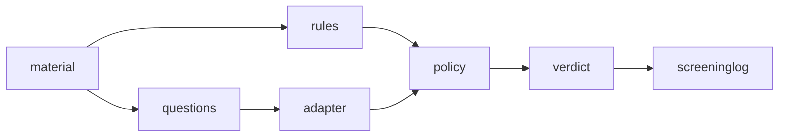

# C4 component

Level 3. Components inside the screener container and their responsibilities.

| Component | Responsibility | Key interface |
|---|---|---|
| `material` | The inbound document: bytes or text, plus provenance metadata | `Material` value object |
| `rules` | Deterministic regex/keyword rules for agent-directed imperatives and known injection markers | `RuleEngine.scan(content) -> tuple[RuleHit, ...]` |
| `questions` | The typed-question schema: `noul`, `choice`, `score` questions with instructions and criteria | `Question` value objects; `parse_answers` |
| `adapter` | Serialises a state plus questions to the System One request, parses the scored response, and normalises it into typed answers | `DecisionInquiry.ask(state, questions) -> dict[str, Answer]` |
| `policy` | Combines rule hits and answer probabilities into a verdict level against configured thresholds | `Policy.decide(hits, answers) -> PolicyDecision` |
| `verdict` | The typed output: level, probabilities, verbatim quarantined passages, thresholds, and escalations | `Verdict` value object |
| `screeninglog` | Append-only JSON-lines record of what was screened and what was decided | `ScreeningLog.append(entry)` |

## Component flow

