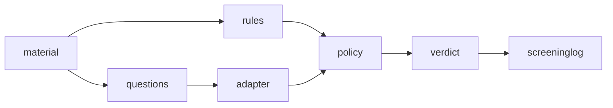

# C4 component

Level 3. Components inside the screener container and their responsibilities.

| Component | Responsibility | Key interface |
|---|---|---|
| `material` | The inbound document: bytes or text, plus provenance metadata | `Material` value object |
| `rules` | Deterministic regex/keyword rules for agent-directed imperatives and known injection markers | `scan(text) -> list[RuleHit]` |
| `questions` | The typed-question schema: `noul`, `choice`, `score` questions with instructions and criteria | `ScreenQuestion` value objects |
| `adapter` | Serialises a state plus questions to the System One request, parses the scored response | `ask(state, questions) -> Answers` |
| `policy` | Combines rule hits and answer probabilities into a verdict level against configured thresholds | `decide(hits, answers) -> Verdict` |
| `verdict` | The typed output: level, probabilities, verbatim flagged passages, screening-log row | `Verdict` value object |
| `screeninglog` | Append-only JSON-lines record of what was screened and what was decided | `log(verdict) -> None` |

## Component flow

