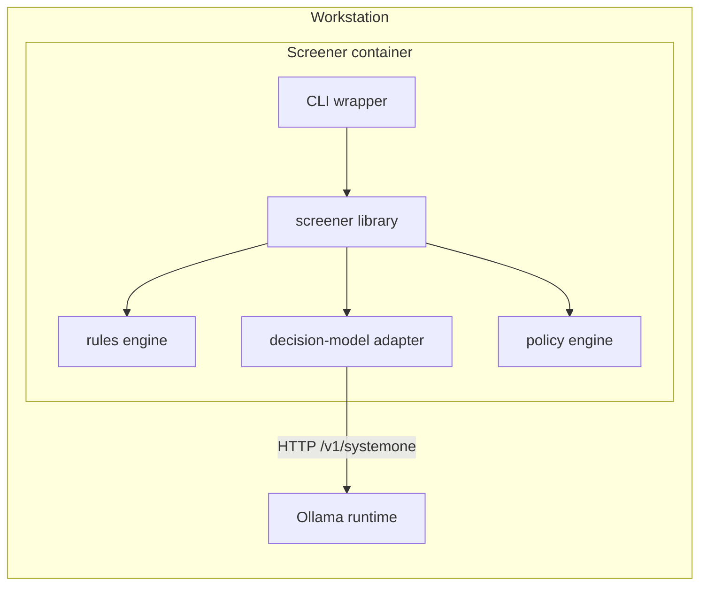

# C4 container

Level 2. The screener is one process family: a library that the calling harness imports, plus a CLI wrapper over the same library.

| Container | Responsibility | Technology |
|---|---|---|
| Screener library | Public API: `screen(material, provenance) -> Verdict` | Python package |
| CLI wrapper | Ad-hoc screening from a shell or a script | Python `argparse` |
| Rules engine | Deterministic pattern scan and quarantine of agent-directed imperatives | Python, pure functions |
| Decision-model adapter | Builds typed questions, calls the System One endpoint, parses scored answers | Python HTTP client |
| Policy engine | Maps rule hits and question probabilities to a verdict level | Python, threshold config |
