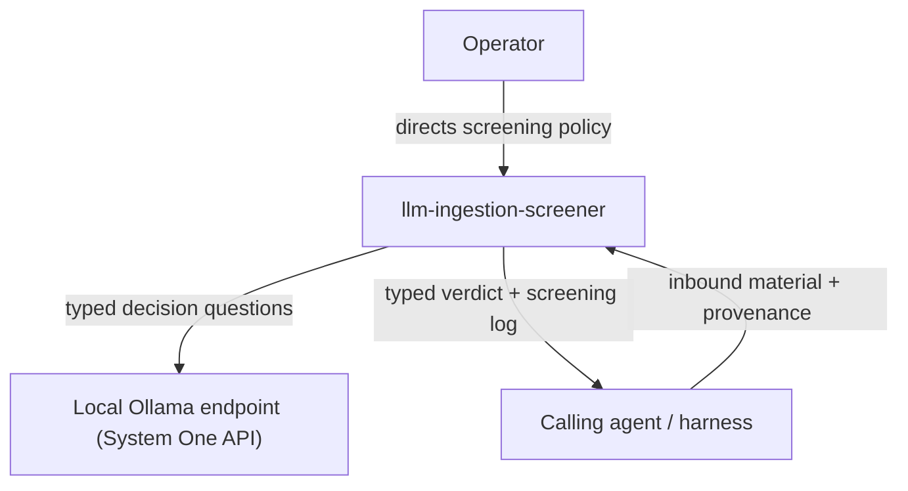

# C4 context

Level 1. The screener is called by an agent harness before the harness admits a document into its context.

## Actors and systems

| Element | Kind | Interaction |
|---|---|---|
| Calling agent / harness | Actor | Passes material and provenance in; receives a verdict and screening log. |
| Operator | Actor | Sets and changes screening policy and thresholds. |
| Local Ollama endpoint | External system | Answers typed decision questions posed by the screener. Runs on the same workstation. |
| Decision models (Clef/Jev/Kev) | External system | Models served by the Ollama endpoint; selected per configuration. |

## Boundaries

Everything runs on the operator's workstation. The screener has no other network dependency, and screened material never leaves the machine.
