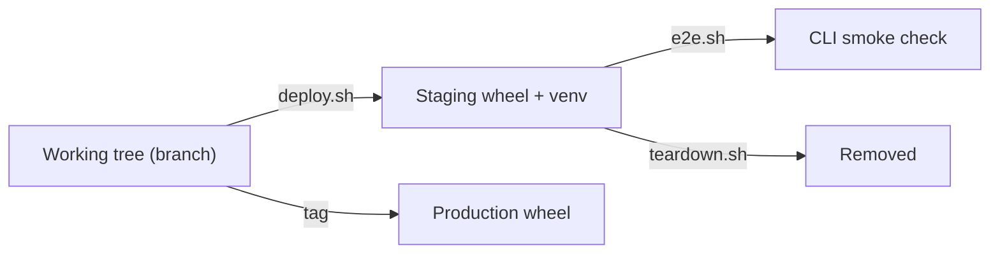

# C4 deployment

Level 4-equivalent: where the screener runs and how releases move.

## Environments

| Environment | What it is | How it is produced |
|---|---|---|
| Local dev | The working tree, run with `uv run` | `uv sync` |
| Staging | A built wheel installed into a fresh venv, per branch | `scripts/staging/deploy.sh <branch>` |
| Production | A tagged release of the same wheel | release tag + `uv build` |

Staging identity is the branch name. The staging directory is `dist/staging/<branch>/` and carries its own venv, so a staging run cannot disturb the dev environment or production.

## Topology

## Notes

- The screener is a library and CLI, so there is no server, no port, and no long-running process to deploy.
- Model serving is out of scope for deployment: the Ollama endpoint and its models are a workstation prerequisite, documented in [`../../DEVELOPER-WORKFLOWS.md`](../../DEVELOPER-WORKFLOWS.md).
